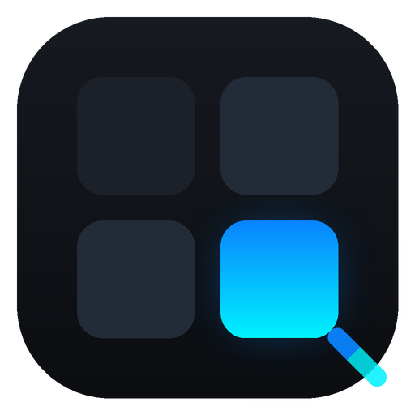

<div align="center">

<h1>Quadro</h1>
<p><b>macOS 多窗格文件工作台</b></p>
</div>

# Quadro — macOS 多窗格文件管理器

一款 Pro 级、暗色美学的 macOS 多窗格文件工作台。品牌配色采用「暗夜黑曜石 + 电光钛蓝 + 极光青」,对标 Raycast / Linear 的现代生产力风格。

## 下载

从 [Releases](https://github.com/banboat/Quadro/releases/latest) 下载：

| 平台 | 文件 |
|------|------|
| macOS 12+（Apple Silicon） | `Quadro-1.0.dmg` |

## 功能

- **1 / 2 / 3 / 4 窗格布局**:顶部工具栏分段切换,或按 `⌘1` ~ `⌘4`
- **焦点高亮**:当前激活窗格以电光钛蓝边框 + 柔光点亮,闲置窗格自动降暗,一眼看清键盘作用于哪个窗格
- 每个窗格独立浏览:双击文件夹进入、双击文件用系统默认程序打开;顶部路径栏可输入路径回车跳转,带后退/前进/上一级
- **标准文件操作(文件和文件夹,可跨窗格)**:`⌘C` 复制、`⌘X` 剪切、`⌘V` 粘贴、`⌘⌫` 删除(移到废纸篓);右键菜单同样提供 复制/剪切/粘贴/删除/重命名。剪切后粘贴即移动,重名自动加「 2」后缀,并与 Finder 剪贴板互通
- **快速流转**:`F5` 复制、`F6` 移动到下一窗格(无需切换焦点)
- **选中高亮与空白处粘贴**:左键单击文件/文件夹即选中并蓝色高亮,`⌘` 点击多选/取消,`⇧` 点击范围选中;点击窗格空白处聚焦后可直接 `⌘V` 粘贴,或在空白处右键选择 粘贴/新建文件夹/刷新
- **自动刷新**:每 5 秒自动刷新各窗格目录,切换到另一个窗格时也会立即刷新,及时看到其他窗格或 Finder 的改动
- **不保存状态**:退出不记录,每次打开都从默认目录(主目录)+ 四窗格开始
- **拖拽**:拖到另一个窗格 = 复制;按住 `⌘` 或 `⌥` 再拖 = 移动;拖拽悬停时目标窗格泛起 15% 电光蓝脉冲
- 重命名、移到废纸篓、新建文件夹
- 底部状态栏显示激活窗格、选中数量与当前路径

## 快捷键

| 功能 | 快捷键 |
| --- | --- |
| 切换布局(1/2/3/4 窗格) | `⌘1` `⌘2` `⌘3` `⌘4` |
| 聚焦下一/上一窗格 | `Tab` / `⇧Tab` |
| 按方位切焦点 | `⌘⌥` + `↑ ↓ ← →` |
| 绝对聚焦 Q1~Q4 | `⌘⌥1` ~ `⌘⌥4` |
| 复制/移动到下一窗格 | `F5` / `F6` |
| 复制 / 剪切 / 粘贴 | `⌘C` / `⌘X` / `⌘V` |
| 删除(移到废纸篓) | `⌘⌫` |
| 后退 / 前进 / 上一级 | 窗格顶部按钮 |

## 如何构建(一条命令)

前置条件:装有 Xcode 或命令行工具。没有的话在终端执行:

```
xcode-select --install
```

clone 或下载本仓库后,在项目目录中执行:

**只要 App:**

```
bash build.sh
```

生成 `build/Quadro.app`,双击即可使用(会自动把 `Quadro.iconset` 转成应用图标)。

**打包成 DMG:**

```
bash make-dmg.sh
```

生成 `Quadro-1.0.dmg`,双击打开后把 Quadro 拖到 Applications 即完成安装。

> 构建说明:
> - 默认使用本机 SDK；如果只有 Command Line Tools、且报 `SwiftUIMacros` 找不到，`build.sh` 会自动尝试 macOS 26.5 SDK。也可以手动指定：
>   ```bash
>   QUADRO_SDK=/Library/Developer/CommandLineTools/SDKs/MacOSX26.5.sdk bash build.sh
>   ```
> - 默认构建 `arm64-apple-macos12.0`；可用 `QUADRO_TARGET` 覆盖。
> - DMG 里的 app 是本地编译、未公证；首次打开如提示「无法验证开发者」，右键 → 打开。

> 提示:首次运行 make-dmg.sh 时,系统可能弹出「终端想要控制 Finder」的授权框,点「允许」即可(用于自动摆好 DMG 里的图标位置);即使拒绝也不会失败。

## 项目结构

```text
Quadro.swift            应用源码（SwiftUI + AppKit）
Quadro.iconset/         各尺寸图标（build.sh 会转成 .icns）
generate_icon.py        重新生成图标（需要 Pillow）
build.sh                编译并生成 build/Quadro.app
make-dmg.sh             编译 + 打包 Quadro-1.0.dmg
Quadro软件设计.md        品牌、配色与交互设计说明
```

## 图标

`Quadro.iconset/` 内含全部尺寸的图标 PNG,`icon-preview.png` 为预览图。若想微调图标(色值、圆角、Q 尾巴),编辑 `generate_icon.py` 后重新运行 `python3 generate_icon.py` 再重新构建即可。

## 常见问题

**打开「下载」「文档」「桌面」等目录提示没有权限**

这是 macOS 的隐私保护(TCC)。任选其一:

- 首次访问时若弹出授权框,点「允许」;或
- 系统设置 → 隐私与安全性 → 完全磁盘访问权限 → 添加 `build/Quadro.app` 并打开开关(应用内错误条也提供「打开系统设置」按钮)

`build.sh` 会优先用稳定的自签名证书签名,授权一次后重新编译不会再反复要求。

**双击提示「无法打开,因为无法验证开发者」**

App 是本地编译、未经过 Apple 公证。任选其一:

- 右键点击 `Quadro.app` → 打开 → 再点「打开」;或
- 终端执行:`xattr -dr com.apple.quarantine build/Quadro.app`

**提示未找到 swiftc**

先执行 `xcode-select --install`。

**编译报错**

把终端里的完整报错信息发给我,我来修。

## 说明

- 应用强制暗色模式(品牌配色本身即暗色体系)。
- 最低系统要求 macOS 12.0。

## 许可证

本项目采用 [CC BY-NC-ND 4.0](https://creativecommons.org/licenses/by-nc-nd/4.0/) 许可证。
